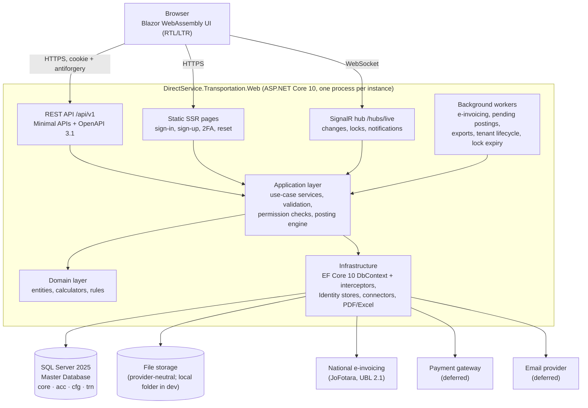
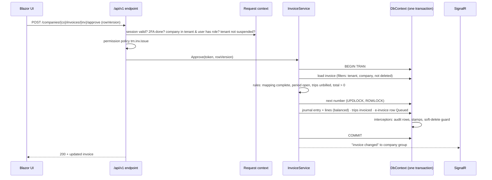

# Direct Service Transportation — Step 2: Architecture and Build Plan (Checkpoint 1)

_Prepared 8 Oct 2026 · Based on the approved step 1 (`docs/step1/`) and the owner decisions in `docs/step1/03_Owner_Decisions.md`._
_Status: **awaiting owner approval (checkpoint 1)**. No code has been written._

Contents
1. What I need from you at this checkpoint
2. Requirements that drive the architecture
3. Architecture overview
4. Solution and layer structure
5. Architecture decisions (ADR-01 … ADR-18)
6. Database design revision 5 — exact proposal (D-02, D-08, D-09)
7. Database collation (A-19)
8. Internal REST API design (API-01 … API-07)
9. Security model — what is checked on every request
10. Build order by module, with dependencies
11. Risks and mitigations
12. Suggestions (not part of the PRD — need your approval)

---

## 1. What I need from you at this checkpoint

| # | Question | My recommendation |
|---|---|---|
| Q-01 | Approve the architecture (sections 3–5, 8–9). | — |
| Q-02 | Approve **revision 5** (section 6): `TRN_Invoices.LayoutType` default 'Claim'; 4 tenant columns on `core.Tenants` for password policy and idle timeout; `core.Companies.Status`. | Option R5-A (columns on `core.Tenants`) |
| Q-03 | **Default idle timeout** for new tenants. The PRD makes it tenant-configurable but gives no default. | 30 minutes (allowed 5–1,440) |
| Q-04 | **Absolute session lifetime**. `core.UserSessions.ExpiresAt` is NOT NULL, but the PRD gives no value. After it, the user signs in again (password + 2FA). | 12 hours, platform setting |
| Q-05 | **Password minimum length floor**. "Minimum 8 … configurable per tenant": may a tenant go **below** 8? | No — allowed range 8–64 |
| Q-06 | **Archived company and the plan limit**. Does an archived company count toward `Plans.MaxCompanies`? | No — only Active companies count |
| Q-07 | **Database collation** (section 7). | `Arabic_100_CI_AI_SC_UTF8` |
| Q-08 | **PDF engine** (ADR-12): HTML + headless Chromium, or QuestPDF (commercial licence above USD 1M revenue). | HTML + headless Chromium |
| Q-09 | Build order (section 10). | As proposed |
| Q-10 | Suggestions S-01 and S-02 (section 12): initialise a local git repository; install Node.js LTS for API linting. | Yes to both |

---

## 2. Requirements that drive the architecture

| Driver | Source | Consequence for the design |
|---|---|---|
| Every feature through the platform's own REST API, versioned, documented, problem details, idempotent creates | API-01…07, NFR-15 | The UI is a client of `/api/v1`; it cannot reach the database or services directly |
| Server-side tenant/company/permission checks on every request; data-layer filtering | SEC-05/06, API-03 | Request context + EF Core global query filters + permission policies on every endpoint |
| Identity on `core.Users`; mandatory 2FA; sessions; no `AspNet*` tables | FR-175…177, SEC-01…04, build prompt | Custom Identity stores; cookie auth with a server-side session row |
| Document + journal entry in one transaction; gap-free numbers under concurrency | NFR-04, BR-038, FR-096 | One `DbContext` transaction per command; `UPDLOCK, ROWLOCK` numbering inside it |
| Soft delete only, append-only audit, RowVersion | BR-041, FR-188, 11.1 | SaveChanges interceptors; no DELETE path in the code; database permissions as a second line |
| Hashed opaque ids in every URL | SEC-22, UX-12 | Keyed, entity-scoped token for every `PublicId` |
| Live updates and record locks (90 s) | FR-185/186, BR-039, RT-01/02 | SignalR hub with company groups; `cfg.RecordLocks` with heartbeat |
| Background jobs never block entry | NFR-17 | Hosted workers reading queue rows that already exist in the design |
| 25 users, 500,000 trips, < 1 s saves, < 3 s monthly reports, horizontal scale | NFR-01/02 | Stateless app, projections + server paging, design indexes, no in-process state that breaks a second instance |
| Arabic-first RTL, A4 Arabic printing, PDF identical to print | UX-02, UX-22/23, NFR-08 | One HTML template per document for preview, print and PDF |
| Hosting, payment gateway, email deferred | DEF-01/02, NFR-22 | Provider-neutral interfaces, container-ready, configuration-driven |
| Single Master Database shared with future projects | NFR-20 | Schema-per-area model; shared entities isolated in their own folders and namespaces so they can later be extracted into a shared package |

---

## 3. Architecture overview

A **modular monolith** with clean layering: one deployable web application (API + UI + real-time hub + background workers) over one SQL Server database. It is horizontally scalable: run more instances behind a load balancer.



Request path for a typical command (e.g. approve an invoice):



---

## 4. Solution and layer structure

```
DirectService.Transportation.slnx
src/
  DirectService.Transportation.Domain           entities, enums, value objects, calculators, domain rules
      Core/  Acc/  Cfg/  Trn/                   one folder + namespace per database schema
  DirectService.Transportation.Contracts        request/response DTOs, permission keys, error codes, shared
                                                validators and resources (referenced by the UI client)
  DirectService.Transportation.Application      use-case services per module, authorization rules, posting engine,
      Platform/ Identity/ Configuration/        interfaces for infrastructure (IEmailSender, IPaymentGateway,
      MasterData/ Pricing/ Trips/ Ledger/       IEInvoiceConnector, IFileStore, IClock, IUrlTokenService …)
      Accounting/ Invoicing/ EInvoicing/
      Cash/ Reports/ Collaboration/ DataExchange/
  DirectService.Transportation.Infrastructure   EF Core DbContext, Fluent configurations, interceptors, migrations,
      Persistence/Configurations/Core|Acc|Cfg|Trn
      Persistence/Interceptors/  Persistence/Migrations/
      Identity/  EInvoicing/JoFotara/  Printing/  Excel/  Email/  Payments/  Files/  Jobs/
  DirectService.Transportation.Web              ASP.NET Core host: API endpoints, SSR account pages,
                                                SignalR hub, background workers, OpenAPI, health checks
  DirectService.Transportation.Web.Client       Blazor WebAssembly UI: pages, components, API client
tests/
  DirectService.Transportation.Domain.Tests             unit (calculations, rules, worked examples)
  DirectService.Transportation.Application.Tests        unit (services with fakes)
  DirectService.Transportation.Infrastructure.Tests     integration against SQL Server (transactions, numbering,
                                                        filters, constraints, interceptors)
  DirectService.Transportation.Api.Tests                API + security/isolation (cross-tenant, permissions, URL tokens)
  DirectService.Transportation.UI.Tests                 Blazor component tests (bUnit)
  DirectService.Transportation.E2E                      Playwright end-to-end, Arabic RTL and English (step 9)
docs/  assets/  BUILD_STATUS.md
```

Dependency rule: `Domain` ← `Application` ← `Infrastructure` ← `Web`; `Contracts` is referenced by `Application`, `Web` and `Web.Client`. `Web.Client` references **only** `Contracts`, so the UI cannot bypass the API. Section 8 business rules live in `Domain`/`Application` (NFR-14), never in the UI or the database (database CHECKs are a second line of defence only).

Entity naming: no prefix in C# (`Trip`), mapped with `builder.ToTable("TRN_Trips", "trn")`; namespaces `DirectService.Transportation.Domain.Trn`, `…Domain.Core`, `…Domain.Acc`, `…Domain.Cfg`.

### Packages (latest stable today; all open licence unless noted)

| Purpose | Package | Version |
|---|---|---|
| Data access | Microsoft.EntityFrameworkCore.SqlServer (+ Design, Tools) | 10.0.12 |
| Identity core (no EF stores) | Microsoft.Extensions.Identity.Core (framework) | 10.0.x |
| OpenAPI document | Microsoft.AspNetCore.OpenApi | 10.0.12 |
| API reference UI (development only) | Scalar.AspNetCore | 2.17.14 |
| Request validation | FluentValidation | 12.1.1 |
| Excel read/write | ClosedXML | 0.105.1 |
| CSV/TSV | CsvHelper | 33.1.0 |
| QR codes | QRCoder | 1.8.0 |
| PDF (headless Chromium) | Microsoft.Playwright | 1.63.0 |
| Metrics/traces | OpenTelemetry.Extensions.Hosting (+ OTLP exporter) | 1.19.1 |
| Health checks | Microsoft.Extensions.Diagnostics.HealthChecks.EntityFrameworkCore | 10.0.12 |
| Tests | xunit.v3 4.0.1 · bunit 2.11.3 · Microsoft.Playwright 1.63.0 | — |

Deliberately **not** used: MediatR (commercial licence since 2025, not needed); Hangfire / Quartz persistent stores and the EF Data-Protection key store (they create tables that are not in the design); AutoMapper (explicit projections are needed for `AsNoTracking` DTO queries anyway).

---

## 5. Architecture decisions

Each decision is short: context → decision → alternatives → consequences.

### ADR-01 — Modular monolith with clean layers
- **Context:** one product, one database, 25 concurrent users per company, a single release, a small team; NFR-14 requires layering.
- **Decision:** a single deployable application split into 14 modules (step 1 §2) inside the clean layers of section 4. Modules talk through application services, never through each other's tables directly, except shared Accounting, which every module posts into through the posting engine.
- **Alternatives:** microservices (rejected: distributed transactions would break NFR-04 "document and entry in one transaction"; heavy operations for no benefit at this scale); a single unlayered project (rejected: NFR-14).
- **Consequences:** + one transaction across modules, simple deployment, easy local debugging. − Module discipline is a code-review matter. Folder/namespace boundaries and an architecture test (layer references) enforce it.

### ADR-02 — Blazor Web App: WebAssembly UI calling the REST API; static SSR for account pages
- **Context:** API-01 says every feature is available through the REST API *used by the Blazor interface*. Data entry is keyboard-heavy (FR-007, UX-03).
- **Decision:** Blazor Web App with **Interactive WebAssembly** rendering for the application, and **static server rendering** for sign-in, sign-up, email verification, 2FA set-up/challenge and password reset (standard secure cookie flows, no WASM download before sign-in). The WASM client calls `/api/v1` on the same origin with the auth cookie and an antiforgery header.
- **Alternatives:** Interactive Server (rejected: the UI would call services in-process, so the REST API would not be the real boundary; every keystroke round-trips over a server circuit; circuits complicate scale-out). Auto mode (rejected: components run in two places, which doubles the testing surface).
- **Consequences:** + The API really is the only door, so server-side checks (SEC-05) cannot be skipped by the UI; instant keyboard response; scale-out needs no sticky circuits. − First load downloads the WASM runtime (a few MB, cached afterwards; acceptable for desktop users ≥ 1280 px). − UI and API DTOs are shared through `Contracts`.

### ADR-03 — Minimal APIs, URL versioning, built-in OpenAPI 3.1, plain application services
- **Decision:** endpoints grouped per module with `MapGroup("/api/v1/…")`; the version in the URL path (API-02); the OpenAPI 3.1 document generated by `Microsoft.AspNetCore.OpenApi` and browsable with Scalar in development only (API is internal: not exposed publicly in production). Each endpoint calls one application service method; no mediator library.
- **Alternatives:** MVC controllers (works, more ceremony); Asp.Versioning package (unnecessary for one version); MediatR (licence, indirection).
- **Consequences:** + Small, fast, explicit; OpenAPI stays in sync with the code automatically. − Cross-cutting behaviour (permission, write-guard, idempotency) is applied with endpoint filters and group conventions, which must be applied on every group. An API test fails if any endpoint lacks a permission requirement.

### ADR-04 — Multi-tenancy: request context, company in the URL, EF Core named query filters
- **Context:** SEC-05/06, 5.1 (company switcher, data never crosses companies), UX-12 (every record has its own URL).
- **Decision:**
  - **Tenant** comes only from the signed-in user (`core.Users.TenantId`), never from input.
  - **Company** is part of every company-scoped route as a hashed token: UI `/c/{company}/trips/{trip}`, API `/api/v1/companies/{company}/trips/{trip}`. On every request the server resolves the token, checks the company belongs to the user's tenant, is not deleted, and that the user holds a role in it (`core.UserCompanyRoles`). Otherwise the result is 404. Two browser tabs can therefore work in two companies without confusion, and links always open in the right company.
  - **EF Core 10 named query filters** on every entity: `SoftDelete` (`IsDeleted = 0`), `Tenant` (`TenantId = ctx.TenantId`), `Company` (`CompanyId = ctx.CompanyId`) according to the table's scope (company / tenant / platform-wide). Only the `SoftDelete` filter is ever switched off, and only for restore screens. The provider console uses a separate, staff-only query service that switches off `Tenant` for platform tables and never reads company business data.
  - Every insert gets TenantId/CompanyId from the context in an interceptor; a value coming from input is ignored.
- **Alternatives:** company held in session state (rejected: breaks multi-tab and shareable URLs); database-per-tenant (rejected: NFR-20 single Master Database); SQL Server row-level security (possible second line later; adds session-context plumbing on every connection — not needed for v1 because filters plus the automated isolation tests satisfy SEC-06).
- **Consequences:** + Isolation is enforced in one place and tested automatically on every build (TST-06). − Pre-authentication look-ups (sign-in by email, invitation tokens) must explicitly bypass the Tenant filter. These are few and reviewed.

### ADR-05 — ASP.NET Core Identity on `core.Users`, cookie authentication, server-side sessions, mandatory 2FA
- **Decision:**
  - `AddIdentityCore<AppUser>()` (**no** `AddRoles`, **no** EF Identity stores) with a custom `UserStore` implementing user, password, email, security-stamp, lockout, two-factor, authenticator-key and recovery-code stores over `core.Users` and `core.UserRecoveryCodes`. Mapping as in A-16. No `AspNet*` table is created.
  - Password hasher: Identity default (PBKDF2, salted). Password rules from the tenant's policy columns (section 6), with fixed lockout of 5 failures → 15 minutes (FR-175).
  - **2FA mandatory:** after a correct password, a user without `TwoFactorEnabledAt` can reach only the 2FA set-up page (authenticator QR + 10 recovery codes, shown once, stored hashed). There is no path that disables 2FA. Reset by `core.users.manage` is audited. Provider staff follow the same rules.
  - Authenticator secret encrypted with ASP.NET Core Data Protection (purpose-specific protector) into `TwoFactorSecret VARBINARY(256)`.
  - **Sessions:** at sign-in a `core.UserSessions` row is created (random token, only its hash stored); the cookie carries the session id. Every request validates: session not revoked, not past `ExpiresAt`, not idle beyond the tenant's timeout, and the user's security stamp unchanged. `LastSeenAt` is updated at most once a minute. Sign-out, sign-out-everywhere, password reset, 2FA reset and role change revoke sessions (SEC-03).
  - Email must be confirmed (`EmailConfirmedAt`) before sign-in (PRD 9.1).
- **Alternatives:** JWT bearer tokens (rejected: tokens in browser storage, harder revocation; cookies are the recommended pattern for same-origin Blazor); EF Identity stores (rejected: creates `AspNet*` tables).
- **Consequences:** + Uses only the design's tables; immediate revocation. − Session validation is one indexed query per request (`IX_UserSessions_UserId_ExpiresAt`), cached in memory for up to 60 s per instance, which is acceptable for NFR-01.

### ADR-06 — Permission-based authorization per company
- **Decision:** policy `perm:<key>` for each of the 22 keys (namespaced per D-01, e.g. `trn.trips.edit`). A handler checks that the current company role (`UserCompanyRoles` → `RolePermissions` → `Permissions`) contains the key. The permission set is cached per (session, company) and dropped on any role or grant change. Every endpoint declares its key; read-only data sources (report builder, search, dashboard cards) filter by key too (FR-141, FR-147, FR-187). A **write guard** endpoint filter blocks every non-GET call for Suspended tenants (BR-010), support sessions (D-13) and archived companies. Plan limits are checked in the services that create limited items (BR-013: never on read/print/export).
- **Alternatives:** Identity roles (rejected: build prompt), role-name checks in code (rejected: custom roles).

### ADR-07 — Hashed opaque identifiers in URLs (SEC-22)
- **Decision:** a URL token is the record's `PublicId` (random GUID) encrypted with **AES-256 using a key derived per entity type** (HKDF from a master key kept in the secret store, with the entity type as context), then base64url-encoded: 22 characters, e.g. `/c/Q9xV…/trips/hT3k…`. The same record always gets the same token (bookmarks work). A token for one entity type cannot open another type. A tampered or random token decrypts to a GUID that does not exist → **404 "not found"**, with no difference between "missing" and "not yours". Internal `BIGINT` ids never appear in JSON, URLs, links, notifications (`core.Notifications.Link`) or exports.
- **Alternatives:** raw GUID in URLs (unguessable, but not "hashed" as the PRD requires, and the same id is usable across entity types); HMAC hash with a look-up column (rejected: needs a new column on every table).
- **Consequences:** + No schema change; deterministic and unguessable. − Rotating the master key invalidates old bookmarks. The key is backed up with the Data Protection key ring, and rotation is documented as a rare operational action.

### ADR-08 — EF Core 10 data-access conventions (as the build prompt specifies)
- One `IEntityTypeConfiguration<T>` per entity (Fluent API only, no schema data annotations); exact names, types, sizes, precision `HasPrecision(18,3)`/`(18,4)`, defaults via `HasDefaultValueSql`, **named** constraints `PK_/FK_/UX_/IX_/CK_/DF_` per the design (EF 10 named default constraints; verified in step 3).
- Filtered unique indexes with `HasFilter("[IsDeleted] = 0 …")`; `IsDescending`, `INCLUDE` and filtered non-unique indexes exactly as listed; every FK `OnDelete(DeleteBehavior.NoAction)`.
- `TRN_Tariffs.Specificity` as a persisted computed column (A-7). JSON columns as `nvarchar(max)` with `ISJSON` checks.
- Interceptors: **(1) context stamping** (TenantId/CompanyId, CreatedAt/By, UpdatedAt/By); **(2) soft delete** (Deleted state → `IsDeleted = 1` + DeletedAt/By/DeleteReason, the reason supplied by the calling service; an attempt to soft-delete without a reason fails); **(3) audit** (one `core.AuditLogs` row per changed row with old → new JSON, the action name supplied by the service — Create, Update, Void, Archive, Restore, Approve…); **(4) append-only guard** (any update or delete of `AuditLogs`, `MaintenanceLogs` or `TRN_RateHistory` throws).
- `RowVersion` is the concurrency token; `DbUpdateConcurrencyException` → **409** with "This record was changed by {user} at {time}. Reload to see the latest version."
- Reads: async, `AsNoTracking`, projection straight to DTOs, server-side paging; split queries where a list needs collections; no lazy loading (prevents N+1).
- **Numbering** (`cfg.NumberSequences`) and the **e-invoice counter** (`cfg.EInvoiceSettings.IcvCounter`): read with `SELECT … WITH (UPDLOCK, ROWLOCK)` inside the document's transaction, then incremented. A rollback releases the number, so there are no gaps (BR-038). This is the only raw SQL in the data access; it will be listed in `BUILD_STATUS.md`.
- Migrations: code-first; the reviewable script comes from `dotnet ef migrations script --idempotent`. No hand-run DDL.
- **Second line of defence (deployment script, not a migration):** the application connects as a dedicated database user with `DENY DELETE` on schemas `core`, `acc`, `cfg`, `trn` and `DENY UPDATE` on `core.AuditLogs` and `core.MaintenanceLogs`. A bug can then never hard-delete or alter audit rows. Listed as raw SQL in `BUILD_STATUS.md`.

### ADR-09 — Posting engine and the transaction boundary
- **Decision:** one application-level unit of work per command: the document change, its journal entry (`acc.JournalEntries` + `acc.EntryLines`), number assignment, audit rows and queue rows are saved in **one transaction** (NFR-04). The posting engine builds entries from the 8.6 table using `acc.PostingKeyMappings`.
  - **Business failures** (unbalanced entry, closed period, unmapped key, inactive account) → the whole operation is refused with a clear message (FR-098).
  - **Technical failures while posting** → rolled back to a savepoint taken before posting; the document is saved and a `acc.PendingPostings` row is written with the reason (FR-101). A worker retries automatically, and users with `acc.je.export` can retry one or all. The `UX_PendingPostings_Source` index guarantees one open row per document.
  - Reversal: a void or edit posts a mirror entry linked both ways (`ReversesEntryId` / `ReversedByEntryId`); originals are never changed (FR-099, BR-035; manual entries per D-05).
- **Consequences:** + Sub-ledgers and GL always agree (G-03 goal; TST-11 reconciliation test). − Long commands must stay short; posting is pure CPU plus a few inserts, so this is fine.

### ADR-10 — Background work with hosted workers on the design's own tables
- **Decision:** `BackgroundService` workers in the web host, switchable per instance by configuration (`Jobs:Enabled`):
  - e-invoice submission (queue = `TRN_EInvoiceSubmissions` / `ApArEInvoiceSubmissions` with Status Queued; retries with back-off; then Rejected + `LastError`, per D-04);
  - pending postings retry; record-lock expiry (90 s); tenant lifecycle (trial end, grace end, 30-day suspension, 90-day retention, data soft-delete per G-18); invitation and grant expiry;
  - exports and the company export package (in-memory queue; the file goes to file storage; a notification with the link is sent when ready, FR-151).
  Rows are claimed with `UPDLOCK, READPAST`, so several instances never process the same row.
- **Alternatives:** Hangfire / Quartz with persistent stores (rejected: they create their own tables, which the design does not allow without approval).
- **Consequences:** + No extra infrastructure. − An export that is running when the application restarts is lost; the user is notified to run it again. This is acceptable because exports are re-runnable.

### ADR-11 — Real-time updates and record locks
- **Decision:** a SignalR hub `/hubs/live` (cookie-authenticated). A connection joins the group of a company only after the same company check as the API (RT-01). After every successful commit the server publishes `{entityType, token, action, byUser}` to the company group, and open lists and dashboards refresh the affected rows (FR-185, UX-20). Record locks (BR-039): opening a form calls `POST …/locks`, which creates a `cfg.RecordLocks` row (the unique index allows one active lock); the client sends a heartbeat every 30 s; closing releases (soft-delete); a worker releases locks idle for more than 90 s. **The server enforces locks:** an update by anyone other than the lock holder is refused with "{name} is editing this record". Lock changes are pushed to the group. On reconnect the client re-joins and reloads changed data (RT-02).
- **Scale-out:** with more than one instance, SignalR needs a backplane (Redis or a managed SignalR service). This is chosen with hosting (DEF-01) and is a configuration switch only.

### ADR-12 — Printing and PDF: one HTML template per document, PDF by headless Chromium
- **Context:** UX-22/23 (A4, Arabic RTL, page X of Y, QR, signatures; **PDF identical to the printout**), NFR-08.
- **Decision:** every printable document (claim statement + annex, tax invoice, credit note, receipt/payment/journal vouchers, statements, report printouts) is an HTML template with print CSS. The **same HTML** is shown in print preview (SCR-09), printed by the browser, and turned into PDF on the server by headless Chromium (Microsoft.Playwright). Browser-grade Arabic shaping and bidirectional text, IBM Plex Sans Arabic embedded, page X of Y via the PDF header/footer templates.
- **Alternatives:** QuestPDF (good RTL support, but a separate layout engine means preview and PDF can differ, and it needs a **paid licence for companies above USD 1M revenue**); iText (AGPL/commercial). Both rejected for v1.
- **Consequences:** + One layout per document, exact match (UX-23). − The container image includes Chromium (~150–300 MB), and PDF rendering costs ~100–300 ms per document. Large batches run as background exports.

### ADR-13 — Excel, CSV and imports
- ClosedXML for .xlsx read/write; CsvHelper for CSV/TSV; paste = TSV parsed the same way. Imports read **cell values only**; a cell holding a formula is rejected with a reason (SEC-13); type, size (configurable, e.g. 10 MB) and row limits are checked before parsing. Arabic header alternatives for automatic column matching live in a mapping dictionary per import type (FR-013). Every import writes a `cfg.ImportBatches` row; preview runs in memory and the commit runs in one transaction per batch (strict) or with per-row results (tolerant).

### ADR-14 — Errors, validation and localisation
- **Errors:** RFC 9457 problem details (`application/problem+json`) everywhere, with `type` = `urn:dst:problem:<code>`, `title`, `status`, `detail` **in the user's language**, `code`, and `errors[]` = `{ field, code, message }` (API-06). Codes catalogue in section 8.4.
- **Validation:** request shape with FluentValidation (shared with the WASM client for instant field errors); business rules in domain/application services, raising `BusinessRuleException(code, field, args)`.
- **Localisation:** Arabic and English `.resx` resources in `Contracts` (shared by API and UI); culture from the user's `LanguageCode`; numbers, dates and amounts formatted per culture, with tabular figures; enumerations stored as English codes and translated in the UI (DB convention).

### ADR-15 — Configuration, secrets and provider-neutral integrations
- Options pattern with validation at start-up; `appsettings.json` (non-secret), **user-secrets** in development, environment variables / a secret store in production. Secrets: connection string, URL-token master key, Data Protection key-ring location, connector credentials. Nothing secret is committed or logged.
- Interfaces with development implementations (DEF-01/02, A-13…A-15): `IEmailSender` (writes `.eml` files to a local folder), `IPaymentGateway` (fake gateway + webhook simulator), `IFileStore` (local folder), `IEInvoiceConnector` (`JoFotaraConnector` + a simulated connector for development and tests), `IClock` (`TimeProvider`).
- Data Protection keys persisted to a configured folder (development) or the provider's key store later (no database table). Losing the key ring makes 2FA secrets and connector credentials unreadable, so it is part of the backup runbook.
- Container-ready: a Dockerfile, health endpoints `/health/live` and `/health/ready`, configuration only through settings (NFR-22).

### ADR-16 — Observability
- Structured logging with the built-in JSON console logger (any log platform can ingest it); a correlation id per request; **no personal data or secrets in logs** (no request bodies, emails masked) (NFR-18). OpenTelemetry metrics and traces with an OTLP exporter (enabled by configuration). Health checks for the database, file storage and the jobs heartbeat. The provider console "platform health" (SCR-94) reads the same metrics.

### ADR-17 — Database collation → section 7.

### ADR-18 — Testing strategy (TST-01…14)
- **Unit** (`Domain.Tests`, `Application.Tests`): every Section 8 rule and calculation, with the PRD's worked examples to 3 decimals (TST-09); amount in words; tariff and rate resolution tables.
- **Integration** (`Infrastructure.Tests`, `Api.Tests`) against a real SQL Server test database created from the migrations once per run. Each test creates its **own tenant and company**, so tests are isolated by the same mechanism the product uses, and no data cleanup (no DELETE) is needed. Covers transactions + journal entries, period locks, referential protection, soft delete, filtered uniques, numbering under concurrency (TST-10), reconciliation (TST-11).
- **Security/isolation** (`Api.Tests`, every build — TST-06): a generated test hits every endpoint as (a) another tenant's user, (b) another company's user, (c) a user lacking the permission, (d) with tampered tokens, and expects 404/403. A test also fails if an endpoint has no permission requirement.
- **UI**: bUnit for components; **Playwright E2E** for the Section 9 flows in Arabic RTL and English (step 9).
- **Coverage gate** ≥ 80 % for Domain + Application (TST-14), reported in step 9.

---

## 6. Database design revision 5 — exact proposal (D-02, D-08, D-09)

All three follow the design's conventions (types, `DF_`/`CK_` names, standard columns unchanged). After approval they are implemented in step 3 and recorded in `BUILD_STATUS.md` and in `docs/design/Database_Design_Revision5.md` ("Changes in revision 5"). The input copy `docs/inputs/Database_Design.md` stays unchanged.

### 6.1 `trn.TRN_Invoices.LayoutType` (D-02)

| Column | Type | Null | Default | Rules |
|---|---|---|---|---|
| LayoutType | VARCHAR(10) | NOT NULL | **'Claim'** (was 'TaxInvoice') | CHECK IN ('Claim','TaxInvoice') — unchanged |

Constraint names: `DF_TRN_Invoices_LayoutType`, `CK_TRN_Invoices_LayoutType`.

### 6.2 Tenant-level settings (D-08)

**Option R5-A (recommended): four typed columns on `core.Tenants`.**

| Column | Type | Null | Default | Description | Rules |
|---|---|---|---|---|---|
| PasswordMinLength | TINYINT | NOT NULL | 8 | Minimum password length for the tenant's users (FR-175). | `CK_Tenants_PasswordMinLength`: BETWEEN 8 AND 64 (Q-05) |
| PasswordRequireLetter | BIT | NOT NULL | 1 | Password must contain at least one letter (FR-175). | — |
| PasswordRequireDigit | BIT | NOT NULL | 1 | Password must contain at least one digit (FR-175). | — |
| SessionIdleTimeoutMinutes | SMALLINT | NOT NULL | 30 (Q-03) | Inactive sessions of the tenant's users expire after this many minutes (FR-176). | `CK_Tenants_SessionIdleTimeoutMinutes`: BETWEEN 5 AND 1440 |

Defaults named `DF_Tenants_PasswordMinLength`, `DF_Tenants_PasswordRequireLetter`, `DF_Tenants_PasswordRequireDigit`, `DF_Tenants_SessionIdleTimeoutMinutes`.
- Edited by users with `core.tenant.manage` on the tenant settings screen (part of SCR-80 / SCR-81 "Tenant"); every change audited (old → new).
- Provider staff (no tenant) use the same rules from platform configuration (`Security:PlatformStaff:*`).
- Fixed by the PRD, **not** configurable: 5 failed sign-ins → 15-minute lock.
- A policy change applies at the user's next password change. It does not force immediate resets (the PRD does not ask for that).
- The absolute session lifetime (Q-04) is a platform setting, not a tenant column.

*Why columns rather than a table:* only four values are needed; typed columns get CHECK constraints and defaults; a tenant always has exactly one value of each, so a separate table would only add a 1:1 join.

**Option R5-B (alternative): new table `core.TenantSettings`**, mirroring `cfg.CompanySettings` for tenant scope: standard columns (tenant-scoped) + `SettingKey VARCHAR(80) NOT NULL`, `SettingValue NVARCHAR(1000) NOT NULL`, `UX_TenantSettings_TenantId_SettingKey (TenantId, SettingKey) WHERE IsDeleted = 0`; keys `CORE.PasswordMinLength`, `CORE.PasswordRequireLetter`, `CORE.PasswordRequireDigit`, `CORE.SessionIdleTimeoutMinutes`. *Pro:* future projects can add tenant-wide keys without schema changes. *Con:* no type checking or CHECK constraints in the database; values parsed and validated by the application only; the table count becomes 67.

### 6.3 `core.Companies.Status` (D-09)

| Column | Type | Null | Default | Description | Rules |
|---|---|---|---|---|---|
| Status | VARCHAR(10) | NOT NULL | 'Active' | Record status. An archived company is hidden from the company switcher and from new work, but all its data is kept and stays viewable and exportable by the Owner. | `CK_Companies_Status`: CHECK IN ('Active','Archived'). Default `DF_Companies_Status`. |

Behaviour (application rules, no further schema):
- Archive and restore: Owner only (`core.tenant.manage`), with a reason, audited.
- An archived company is **read-only** for everyone (the write guard in ADR-06), and only the Owner sees it (in SCR-81 Companies, for view/print/export).
- A tenant must keep at least one Active company (the last one cannot be archived).
- Plan limit: only Active companies count toward `MaxCompanies` (Q-06).
- `core.Users.DefaultCompanyId` pointing to an archived company falls back to the user's first active company at sign-in.
- `UX_Companies_TenantId_Name … WHERE IsDeleted = 0` is unchanged, so an archived company still reserves its name (same as materials and sites).
- Placement: added after `MigrationCompletedAt` and before the standard audit columns (column order cosmetic; EF follows the entity order).

---

## 7. Database collation (A-19 / Q-07)

Tested on your SQL Server 2025 instance (read-only queries, 8 Oct 2026):

| Comparison | SQL_Latin1_General_CP1_CI_AS (server default) | Latin1_General_100_CI_AI | Arabic_100_CI_AS | **Arabic_100_CI_AI(_SC_UTF8)** |
|---|---|---|---|---|
| tashkeel (مُحَمَّد vs محمد) | different | different | different | different |
| tatweel (محـــمد) | equal | equal | equal | equal |
| alef with hamza / madda (أ إ آ vs ا) | different | different | different | different |
| ta marbuta / ha, alef maqsura / ya | different | different | different | different |
| Latin case (ABC = abc) | equal | equal | equal | equal |
| Latin accents (café = cafe) | different | equal | different | equal |
| Arabic-Indic digits (١٢٣ = 123) | different | equal | different | **equal** |
| Arabic text stored in a `VARCHAR` column (`١٢٣-ب٤`) | `???-??` **data lost** | `???-??` **data lost** | `123-ب4` (digits changed) | **cp1256:** `123-ب4` · **UTF8:** `١٢٣-ب٤` (exact) |

Findings:
1. **No SQL Server collation equates hamza forms, ta marbuta or tashkeel.** Arabic spelling-variant search (US-29 / FR-187) therefore needs the application-side normalisation already agreed in A-12, whatever the collation.
2. The server default code page 1252 **silently destroys** Arabic characters typed into the design's `VARCHAR` columns (plate, licence, tax and IBAN numbers, phone). That is a data-loss risk.
3. Accent-insensitive collations treat Arabic-Indic and Western digits as equal. This helps searching and the receipt-number uniqueness rule (a receipt typed as ١٢٣ is the same as 123).

**Recommendation: `Arabic_100_CI_AI_SC_UTF8`** for the database (set in the EF model with `UseCollation`, applied when the database is created):
- case- and accent-insensitive comparison and uniqueness;
- Arabic-Indic digits = Western digits;
- UTF-8 storage for `VARCHAR`, so no character is ever lost in code/number columns, which also suits the shared Master Database used later by other markets and projects (NFR-09/20);
- Arabic linguistic sort order for names.

The application additionally normalises code and number fields (Arabic-Indic → Western digits, trimmed) before saving, so stored values are consistent for exports and e-invoicing.
- Caveat: in UTF-8 a `VARCHAR(n)` length counts **bytes**; an Arabic letter takes 2. These columns are designed for codes and numbers (mostly ASCII), so the sizes in the design remain correct.
- Caveat: the server default (`SQL_Latin1_General_CP1_CI_AS`) still applies to `tempdb`. Any raw SQL that uses temporary tables must use `COLLATE DATABASE_DEFAULT`; EF Core-generated SQL does not use temporary tables. Step 3 includes a check query.
- Alternative: `Arabic_100_CI_AI` (code page 1256): same comparison behaviour, 1 byte per Arabic letter in `VARCHAR`, but it silently converts Arabic-Indic digits and drops characters outside the code page.

---

## 8. Internal REST API design (API-01 … API-07)

### 8.1 Conventions
- Base path `/api/v1`; JSON with camelCase; dates `yyyy-MM-dd`, timestamps ISO-8601 UTC, months `yyyy-MM`; money and weights as JSON **numbers with fixed decimals** serialised from `decimal`, never floating point.
- Identifiers: only URL tokens (ADR-07) in paths and bodies, field name `id`; related records as `{ id, name }`.
- Resource URIs are nouns; actions that are state transitions are sub-resources with POST: `…/invoices/{id}/approve`, `…/void`, `…/trips/{id}/clear-review`. Each is idempotent: approving an approved invoice returns the current state.
- Company scope: `/api/v1/companies/{company}/…`; tenant scope (Owner): `/api/v1/tenant/…`; current user: `/api/v1/me/…`; provider console: `/api/v1/platform/…` (platform staff only); anonymous: `/api/v1/auth/…` (rate-limited).

### 8.2 Lists — paging, sorting, filtering (API-04)
- `GET …/trips?page=1&pageSize=50&sort=-tripDate,receiptNo&status=active&from=2026-10-01&to=2026-10-31&q=…`
- Response: `{ items: [...], page, pageSize, totalCount, totals: { … } }`; `pageSize` ≤ 200; `totals` for lists that show a totals row (UX-15).
- Offset paging (users need page numbers and counts; design indexes support the filters). Full exports do not page through the API: they stream server-side as background jobs (FR-151).
- Sort and filter fields are white-listed per resource; anything else → 400.

### 8.3 Writes — validation, concurrency, idempotency
- **Create** (API-05, G-13): the client generates the new record's `PublicId` and sends it (`clientId`). A repeat of the same create returns the already-created record (`200` instead of `201`), using the unique `PublicId` index. No extra table.
- **Update/void/approve** carry `rowVersion` (base64). A mismatch → **409** `concurrency.conflict` with who/when.
- **Locks:** an update without holding the record lock while another user holds it → **423** `lock.held` ("{name} is editing this record").
- Field validation → **400** with `errors[]`; business-rule refusal → **422** with code (e.g. `period.closed`); missing permission → **403**; unknown/foreign token → **404**; tenant read-only / archived company → **403** `tenant.readOnly` / `company.archived`; plan limit → **409** `plan.limitReached` with upgrade info; rate limit → **429** + `Retry-After`.

### 8.4 Problem-type catalogue (initial; grows per module)

| Code | HTTP | Example message (EN) |
|---|---|---|
| validation.required | 400 | Field «Receipt number» is required. |
| validation.format | 400 | Phone must be a local mobile number (07[789]XXXXXXX or 06XXXXXXX). |
| validation.range | 400 | Loaded weight must be greater than 0. |
| auth.unauthenticated | 401 | Please sign in. |
| auth.forbidden | 403 | You do not have permission to do this. |
| tenant.readOnly | 403 | Your subscription is suspended; you can view, print and export only. |
| company.archived | 403 | This company is archived and read-only. |
| notFound | 404 | Not found. |
| concurrency.conflict | 409 | This record was changed by {user} at {time}. Reload to see the latest version. |
| duplicate.key | 409 | Receipt number TRP-123 already exists in this company. |
| plan.limitReached | 409 | Your plan allows {n} trips per month. Upgrade to add more. |
| lock.held | 423 | {user} is editing this record. |
| period.closed | 422 | {date} is in the closed period {month}. |
| posting.mappingIncomplete | 422 | Complete account mapping ({n} missing). |
| reference.inUse | 422 | Cannot delete — linked to 4 trips · 1 tariff line. Archive instead. |
| rate.missing | 422 | No driver rate for {site}, {month}, {fleet}. |
| tariff.locked | 422 | Price differs from the tariff; tariff lock is on. |
| amount.exceedsBalance | 422 | Amount exceeds the remaining balance of {amount}. |
| rateLimited | 429 | Too many requests. Try again in {n} seconds. |

### 8.5 Resource catalogue (top level, per module)

| Module | Resources under `/api/v1/companies/{company}` unless noted |
|---|---|
| M01 Platform | `/auth/sign-up`, `/tenant` (settings, subscription, invoices, companies, usage, support-access requests, export), `/platform/tenants`, `/platform/plans`, `/platform/support-access`, `/platform/announcements`, `/platform/health` |
| M02 Identity | `/auth/sign-in`, `/auth/2fa`, `/auth/password-reset`, `/auth/email-verification`, `/me` (preferences, sessions, recovery codes), `users`, `roles`, `permissions`, `invitations` |
| M03 Configuration | `settings`, `number-sequences`, `custom-fields`, `standard-fields`, `column-views`, `einvoice-settings`, `setup-checklist` |
| M04 Master data | `drivers`, `customers`, `partners`, `materials`, `loading-sites`, `unloading-sites`, `ownership-types` (+ `/{id}/archive`, `/restore`, `/history`, `/references`) |
| M05 Pricing | `tariffs`, `monthly-rates/{yyyy-MM}`, `rate-history` |
| M06 Trips | `trips` (+ `/quick-entry-defaults`, `/recent`, `/{id}/void`, `/{id}/clear-review`, `/{id}/history`), `trip-imports` (preview, commit) |
| M07 Ledger | `posting-keys`, `journal-entries` (automatic + manual), `pending-postings` (+ retry), `journal-exports` |
| M08 Accounting | `accounts` (tree, import, export, opening balances), `cost-centres`, `cash-boxes`, `bank-accounts`, `periods` (+ pre-close, close, reopen), `apar-parties`, `apar-documents`, `apar-payments`, `apar-returns`, `maintenance` |
| M09 Invoicing | `invoices` (+ `/unbilled-trips`, `/{id}/approve`, `/void`), `credit-notes`, `invoice-layouts`, `prints/{documentType}/{id}` |
| M10 E-invoicing | `einvoice-submissions` (+ `/{id}/submit`) |
| M11 Cash | `receipts`, `advances`, `settlements` (+ `/draft` calculation), `partner-payments`, `driver-accounts/{driver}`, `partner-accounts/{partner}` |
| M12 Reports | `dashboard`, `dashboard-pins`, `reports/{reportKey}`, `report-builder/sources`, `saved-reports` |
| M13 Collaboration | `locks`, `search`, `notifications` (under `/me`), `audit-log`; hub `/hubs/live` |
| M14 Data exchange | `exports` (background jobs), `imports/{entityType}` |

The OpenAPI 3.1 document is generated from the code. Each module's API is linted (Redocly CLI, needs Node — S-02) and reviewed when the module is delivered (step 4).

---

## 9. Security model — what is checked on every request

| # | Check | Where | Requirement |
|---|---|---|---|
| 1 | HTTPS only, HSTS, security headers (CSP, frame-ancestors none, nosniff, referrer policy) | middleware | SEC-08, SEC-12 |
| 2 | Rate limit (per IP for `/auth/*`, per tenant for the API) | rate limiter | SEC-14, API-07 |
| 3 | Cookie valid → session row valid, not idle/expired/revoked, security stamp current | authentication handler | SEC-03, FR-176 |
| 4 | 2FA completed (otherwise only the 2FA set-up/challenge endpoints) | authorization policy | FR-177 |
| 5 | Antiforgery token on every non-GET request | endpoint filter | SEC-12 |
| 6 | Company token → company of the user's tenant + user role in it (or an approved, active support grant) | company-context filter | SEC-05, BR-014 |
| 7 | Permission key of the endpoint | policy `perm:<key>` | 3.3, API-03 |
| 8 | Write guard: tenant Suspended/Cancelled, company archived, support session → no writes | endpoint filter | BR-010, D-13 |
| 9 | Data access: Tenant/Company/SoftDelete query filters; stamps from context | EF Core | SEC-06 |
| 10 | Business rules (period, locks, plan limits, references…) | application services | Section 8 |
| 11 | Audit row for every change, sign-in, failed sign-in, export, print, permission change, support request | interceptor + services | FR-188, SEC-16 |

Support sessions (D-13): a platform-staff user with an Approved grant inside its window gets a read-only context for that tenant (all view keys, no write keys). Every request in the window is written to the tenant's `core.AuditLogs` with Action `SupportAccess`, and the tenant sees these entries in its audit log.

---

## 10. Build order by module, with dependencies

```mermaid
graph LR
    S3["Step 3<br/>Database: all 66 tables,<br/>rev. 5, seed, verification"] --> B1
    B1["B1 Foundation & identity<br/>X + M02 + core of M01/M03"] --> B2
    B2["B2 Accounting core + posting engine<br/>M08 (chart, periods, cash/banks, cost centres)<br/>+ M07 (mapping, posting, pending, manual journal)"] --> B3
    B3["B3 Master data<br/>M04"] --> B4
    B4["B4 Pricing<br/>M05"] --> B5
    B5["B5 Trips<br/>M06 incl. import"] --> B6
    B6["B6 Invoicing & credit notes<br/>M09 incl. layouts, printing/PDF"] --> B7
    B7["B7 E-invoicing<br/>M10"] --> B8
    B6 --> B8["B8 Cash, drivers & partners<br/>M11"]
    B8 --> B9["B9 AP/AR, financial reports,<br/>maintenance (rest of M08)"]
    B9 --> B10["B10 Reports, dashboard,<br/>report builder M12"]
    B10 --> B11["B11 Search, notifications,<br/>audit-log viewer M13"]
    B11 --> B12["B12 Tenant & provider platform,<br/>data exchange M01 rest + M14"]
```



| Block | Content | Depends on | Key tests |
|---|---|---|---|
| **Step 3** | All entities, Fluent configurations, DbContext, interceptors, initial migration with revision 5, idempotent script, seed (22 permissions, TRIAL plan), design-vs-database verification report; the chart-of-accounts template + default mapping **drafted for your approval** (D-10) | approved step 2 | migration applies; verification queries match the design 1:1 |
| **B1** Foundation & identity | Request context, query filters, URL tokens, problem details, localisation, OpenAPI; sign-up (tenant + Owner + first company + preset roles + terms), email verification, sign-in, mandatory 2FA, recovery codes, sessions, password reset, lockout, tenant password/idle settings; users, roles, invitations, permissions (FR-172…178, BR-001…003); companies (create, archive, switch); company settings, numbering service (FR-168…171, BR-037/038), period guard; record-lock API + SignalR hub skeleton (used by every later edit form); background-worker host; dev email/file implementations | Step 3 | isolation + permission test harness (TST-06) created here and extended by every block; concurrency numbering test (TST-10) |
| **B2** Accounting core + posting engine | Chart of accounts (tree, template, import/export, opening balances with the difference account, FR-107…110), cost centres, cash boxes, bank accounts, periods (close/reopen, pre-close check); posting-key mapping (FR-092…095), posting engine (8.6), reversals, pending postings + retry, automatic-entries list, journal voucher, journal export (FR-096…104); manual journal create/edit/void/import (FR-111…115, D-05) | B1 | balanced/closed-period refusal; savepoint → pending posting; reversal links |
| **B3** Master data | Drivers with truck, customers, partners, materials, sites, ownership types; archive/restore, reference counts, rename, history, import/export, custom fields on drivers/customers, standard-field config (FR-152…167, FR-179…183) | B1 | uniqueness incl. Arabic digits; reference protection |
| **B4** Pricing | Tariffs, specificity resolution, rate history; monthly site rates with month strip (FR-019…037) | B3 | tariff and rate resolution tables (unit) |
| **B5** Trips | Quick entry, full form, calculations, frozen rates, wage/partner-cost posting, edit/void with reversal, shortage, breach, Needs review, import, history, Created Trips list (FR-001…018) | B2, B4 | EX-1; posting per 8.6; 500,000-trip list performance smoke test |
| **B6** Invoicing & credit notes | Trip picker, manual invoices, drafts/approval, numbering, posting, void, credit notes with shares, layouts + designer, printing/PDF engine, QR, amount in words (FR-038…058) | B5 | EX-2, EX-3; BR-027 rounding absorption; concurrent approvals |
| **B7** E-invoicing | Settings with encrypted credentials, UBL 2.1 build + validation, connector interface + JoFotara + simulator, ICV counter, submission worker, retries, rejected/resubmit, credit-note rules, AR documents (D-15) (FR-059…066) | B6 | simulator tests; JoFotara test environment when credentials are provided (TST-04) |
| **B8** Cash, drivers & partners | Receipts, advances, settlements with deductions, partner payments, vouchers, driver/partner accounts and statements (FR-067…091) | B6 (receipts against invoices), B2 | EX-4; BR-031/032; partner balance cap |
| **B9** AP/AR & financial reports | Parties, supplier bills, receivable documents, payments, returns, ageing; GL, trial balance, P&L, balance sheet, account statements, cost-centre report, drill-down; maintenance zone (FR-116…136) | B2, B7 (AR e-invoicing) | trial balance balances; maintenance protections |
| **B10** Reports & dashboard | Dashboard cards and alerts, pins with thresholds, RPT-01…23, report builder, saved reports, Excel/PDF exports, background exports (FR-137…151) | B5–B9 | reconciliation (TST-11) on the reference month; report timings (NFR-01) |
| **B11** Collaboration | Live updates on every list, global search with Arabic normalisation, notifications, audit-log viewer and export (FR-185…190) | all business blocks | lock/live E2E; search variants |
| **B12** Platform & data exchange | Subscription (plans, upgrade/downgrade, credits per D-11, invoices, payment-gateway interface + webhook), tenant lifecycle worker, provider console (tenants, plans, support access, announcements, health), setup checklist, demo company, company export package, anonymisation (SEC-19) | B1–B11 | lifecycle state machine; downgrade refusal (BR-012) |
| Help pages (D-18) | Short Arabic/English help page per main flow | end of build | — |

Steps 5–7 (design directions, mockups, design system) can run between backend blocks. **No UI code is written before the mockups are approved (step 6).** Each block ends with code review, security review for auth/isolation/money modules, tests green, the traceability matrix updated, and a stop for your review (step 4 rule).

---

## 11. Risks and mitigations

| # | Risk | Mitigation |
|---|---|---|
| R-01 | JoFotara test credentials/environment not available in time (RSK-01) | Connector interface + simulator; you obtain test credentials before B7; UBL validation unit-tested independently |
| R-02 | Cross-tenant leak (RSK-02) | Single context source, named filters, generated isolation tests on every endpoint, review of every filter bypass |
| R-03 | Rounding / calculation disputes (RSK-03) | One `Money` rounding helper (half-up, currency decimals); worked examples as tests; reconciliation test |
| R-04 | Numbering gaps under concurrency (RSK-04) | Number assignment inside the transaction with `UPDLOCK, ROWLOCK`; parallel-approval test |
| R-05 | Shared tables later needed by a sister project with its own migrations | Shared entities kept in their own namespaces/folders; when a second project starts, the shared model is extracted into a package that owns the shared migrations. Documented now, not built now (no scope drift) |
| R-06 | Chromium in the container (size, patching) | Pinned version, separate render worker possible later; alternative engine behind `IPdfRenderer` |
| R-07 | Data Protection key ring loss → 2FA secrets and credentials unreadable | Key ring persisted outside the app and included in backups (runbook); documented recovery = 2FA reset by users.manage |
| R-08 | WASM first-load time on slow links | Compression, caching, trimmed assemblies; account pages are server-rendered so sign-in is instant |
| R-09 | EF Core 10 cannot express a design detail exactly (e.g. a constraint name) | Checked table by table in step 3; any gap reported to you before raw SQL is considered |
| R-10 | Performance at 500,000 trips | Design indexes, projections, server paging, smoke test in B5, full test in step 9 (TST-05) |

---

## 12. Suggestions (not in the PRD — waiting for your approval)

| # | Suggestion | Why |
|---|---|---|
| S-01 | Initialise a **local git repository** in the code folder (no remote, nothing pushed). I commit only when you ask. | Safe history and easy rollback during a long build; lets you review each block as a diff |
| S-02 | Install **Node.js LTS** on this computer (developer tool only, not part of the product) | Needed for the API linter (Redocly CLI) the API skill requires, and for Playwright tooling in step 9 |
